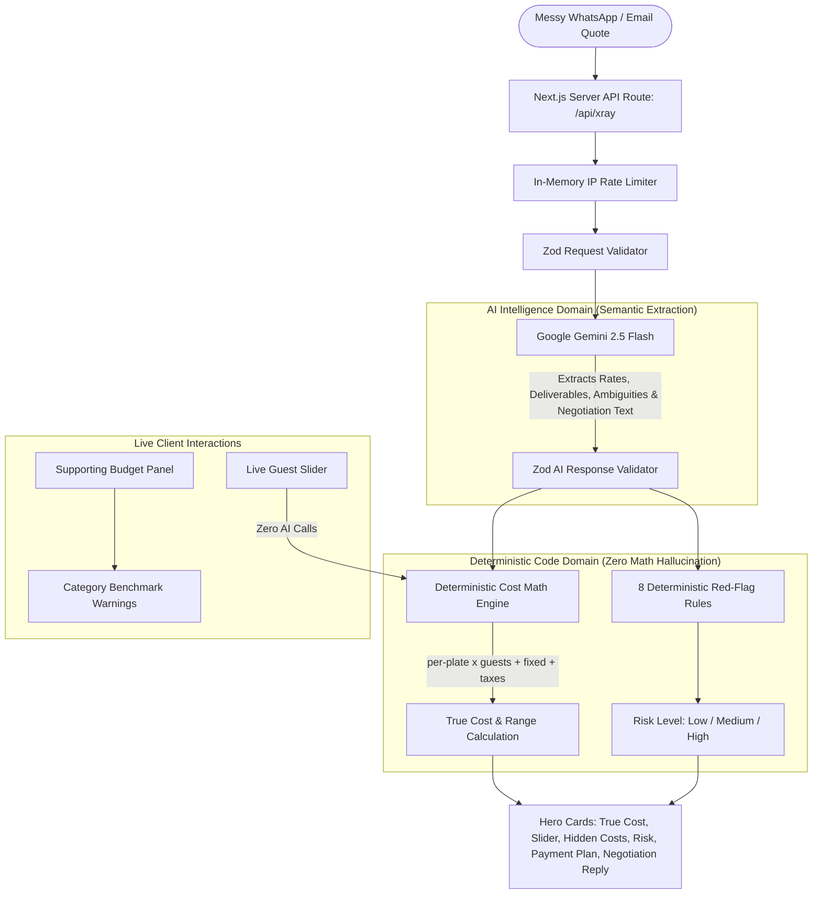

# Quote X-Ray 🔍🛡️

> **"Don't pay the advance until you've X-Rayed the quote."**  
> *An AI-powered consumer protection tool designed to help Indian families decode messy vendor quotes for weddings and events before paying advances.*

---

## 1. Problem Statement & Target Audience

In India, wedding and event vendor quotes are almost never formal PDFs. They are messy WhatsApp forwards, voice notes translated to text, or hasty emails filled with vague phrases like *"bhaiya plate 1150 padega, baaki diesel as per actuals, advance 60% cash me dena hoga"*.

Families routinely suffer from:
1. **The Advance Trap:** Paying 50%–70% upfront cash or personal UPI transfers with zero written contracts, eliminating all leverage if service is disastrous.
2. **The "Free Venue" Illusion:** Banquet halls advertising "free lawn/hall" while silently inflating per-plate rates and levying mandatory fees for cleaning, AC, and generator diesel.
3. **Hidden Surcharges:** Unexpected wedding-day line items (waitstaff tips, crockery washing, cake cutting charges, overtime past 11 PM) that blow up family budgets by 20%–30%.

### Target Audience
Middle-class Indian families planning weddings, engagements, and milestone functions who need transparent financial clarity and protection against predatory vendor clauses.

---

## 2. Core Architecture: Semantic AI + Deterministic Financial Math



### Where AI is Used:
- Parsing messy, colloquial Hinglish WhatsApp forwards with irregular spelling.
- Identifying unstated deliverables and ambiguous phrasing.
- Drafting 3 culturally calibrated, polite negotiation messages (English, Hinglish, Hindi) ready to paste into WhatsApp.

### Where AI is Deliberately FORBIDDEN:
- **True Cost Calculation:** Evaluated strictly in code (`perUnitPrice * guests + fixedCharges + extras + taxes`).
- **Live Guest Slider:** Cost updates instantaneously in TypeScript without calling Gemini or incurring latency.
- **Red-Flag Scoring:** Deterministic rules run first (advance > 50% = High Risk; full prepayment = High Risk; cash/personal UPI = Warning; no written agreement = Warning; no refund = Warning).

---

## 3. Hero Feature Walkthrough

1. **Quote Extraction:** Extracts vendor name, category, per-plate rate, fixed charges, deliverables included/excluded, taxes, and advance terms.
2. **True All-In Cost:** Computes true cost and displays the transparent formula (e.g. `(₹1,100/plate × 250 guests) + Fixed (₹25,000) + 5% GST = ₹3,15,000`). If ambiguities exist, displays an estimated range with an `Estimate (assumption)` badge.
3. **Live Guest Slider:** Range slider (25 to 1000+ guests) with instant cost recalculation. Visualizes variable per-head scaling vs fixed lump-sum charges.
4. **Hidden Cost Detector:** Detects likely omitted costs (generator diesel, service charges, overtime, staff tips, cleaning fees) formulated as investigative questions to ask.
5. **Risk Score:** Hybrid evaluation (rules first, AI second). Assigns Low, Medium, or High risk with clear reasons.
6. **Safer Payment Plan:** Generates milestone-based payment schedules (e.g., 20% advance, milestone payments, final 15% post-event) and vendor-specific "Get This in Writing" checklists.
7. **WhatsApp Negotiation Reply:** Ready-to-copy polite response in Hinglish, English, or Hindi asking the missing questions, requesting a formal GST bill, and proposing the safe payment schedule.
8. **Side-by-Side Comparison:** Compare up to 3 quotes side by side. Highlights **Best Value** and **Safest Option** with explicit rationales.
9. **Supporting Budget Panel:** Small panel tracking quote share against total family event budget, with benchmark warnings (e.g., catering > 40%).

---

## 4. Tech Stack

- **Framework:** Next.js 15 (App Router) + TypeScript
- **Styling:** Tailwind CSS with warm Maroon (`#6b1530`), Saffron (`#ff7b11`), and Cream (`#fdf8f0`) palette.
- **AI Engine:** Google Gemini 2.5 Flash via official `@google/generative-ai` SDK (server-side only).
- **Validation:** Zod schemas on both request inputs and AI extraction responses.
- **Testing:** Vitest + React Testing Library + jsdom.

---

## 5. Local Setup & Testing

### 1. Installation
```bash
git clone https://github.com/lazykaizer/event_planner.git
cd event_planner
npm install
```

### 2. Configure Environment
```bash
cp .env.example .env.local
```
Add your Gemini API key to `.env.local`:
```env
GEMINI_API_KEY=your_gemini_api_key_here
```

### 3. Run Development Server
```bash
npm run dev
```
Open [http://localhost:3000](http://localhost:3000) in your browser.

### 4. Run Test Suite
```bash
npm run test
```
Executes Vitest tests covering deterministic cost math, guest slider recalculation, red-flag rules, Zod schema validation, and input boundaries.

---

## 6. Deployment Guide

### Vercel
1. Import repository to [Vercel](https://vercel.com).
2. Set `GEMINI_API_KEY` in Environment Variables.
3. Deploy! Next.js App Router serverless functions handle the `/api/xray` route automatically.

### Google Cloud Run
Build and deploy container:
```bash
gcloud run deploy quote-xray \
  --source . \
  --platform managed \
  --region asia-south1 \
  --allow-unauthenticated \
  --set-env-vars GEMINI_API_KEY="your-api-key"
```
