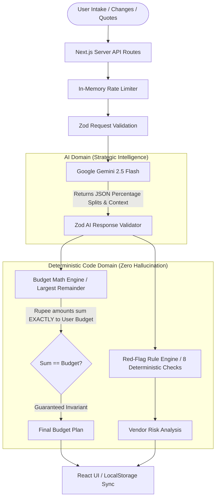

# Shaadi Guardian — AI Celebration & Wedding Financial Advisor 💍🛡️

> **GenAI Hackathon Challenge Submission: Celebration and Event Planner**  
> *A pragmatic, zero-inflation celebration planner tailored for middle-class Indian families (₹2 Lakh to ₹25 Lakh budget).*

---

## 1. Problem Statement & Target Audience

In middle-class Indian households, weddings and milestone celebrations are emotional, once-in-a-lifetime occasions. However, families routinely face severe financial distress due to three persistent realities:

1. **The 20–30% Budget Creep:** Budgets begin at ₹8 Lakh and finish above ₹11 Lakh, with catering plate mathematics and sudden decor additions being the primary culprits.
2. **Predatory Vendor Clauses & Advance Traps:** Vendors demand 50–70% upfront cash or personal UPI deposits with zero written contracts, "free venue" claims masking inflated per-plate charges, or strict "no refund" terms.
3. **The Disruption Re-planning Bottleneck:** When circumstances change (a family member can only contribute ₹6 Lakh instead of ₹8 Lakh, the guest list jumps from 200 to 320, or the auspicious *muhurat* date moves 3 weeks earlier), families often panic and restart planning from zero, or make blind cost cuts that compromise core hospitality.

### Target User
Middle-class Indian families organizing weddings, engagements, anniversaries, or Griha Pravesh ceremonies with an overall budget between **₹2 Lakh and ₹25 Lakh**.

---

## 2. Core Architectural Philosophy: AI Empathy + Deterministic Math

Large Language Models excel at understanding cultural nuances, trade-off psychology, and unformatted WhatsApp messages. However, **LLMs are inherently non-deterministic and hallucinate financial math**. 

**Shaadi Guardian enforces strict architectural separation:**



### Where AI is Used:
- Determining realistic category allocation percentages based on local city tier, guest count, and ranked priorities.
- Parsing unstructured, colloquial vendor messages (e.g. WhatsApp quotes).
- Explaining real-world compromises in natural language (e.g. *"Cutting decor from ₹1.5L to ₹70k replaces fresh floral mandaps with fabric drapes"*).
- Bilingual reasoning in Hindi (Devanagari) and English.

### Where AI is Deliberately FORBIDDEN:
- **Rupee Arithmetic:** All multiplications, integer conversions, rounding, and residual distributions are executed in deterministic TypeScript via the **Largest Remainder Method**. If a user enters ₹8,00,000, the sum of all 10 categories is guaranteed to equal ₹8,00,000 down to the rupee.
- **Confirmed Prices:** The system **never** claims a vendor rate is confirmed or that a vendor is available on a specific date. All numbers carry an `Estimate (assumption)` badge with explanatory tooltips.
- **Legal Advice:** Red-flag checks carry clear guidance disclaimers.

---

## 3. Key Features

### F1. Smart Conversational Intake
- 4-step guided intake wizard (Occasion, Budget & Guests, Ranked Priorities, Must-haves & Cultural Notes).
- **"Load Sample Scenario" Button:** One-click prefill with a realistic Jaipur wedding scenario (₹8 Lakh, 200 guests, 4 months away) to streamline evaluation demos.
- Indian currency formatting (`₹8,00,000`) and date validation.

### F2. Budget Breakdown (Chart & Live Table)
- Responsive zero-dependency SVG **Donut and Bar Charts** with an Indian festive palette (Maroon, Saffron, Gold, Emerald, Peacock Teal).
- Interactive rebalancing table: users can manually edit any rupee amount; remaining categories automatically rebalance while preserving user overrides.
- Live overbudget / underbudget status alerts.

### F3. What-If Simulator (Hero Feature)
- Type changes in plain natural language (e.g., *"budget dropped by 20%"*, *"guests increased to 300"*, *"we want double spend on photography"*).
- Evaluates the change into a structured delta and generates **2 to 3 distinct strategic trade-off options** rather than cutting spending evenly across all categories.
- Side-by-side **Before vs After** comparison table showing exact rupee and percentage differences.
- **Version History & Undo:** Revert to any prior plan version without losing data.

### F4 & F5. Vendor Quote Parser & Red-Flag Checker
- Ingests messy, unformatted quotes from WhatsApp or emails.
- Extracts deliverables, pricing per plate, excluded items, advance requested, and missing information.
- **Hybrid Red-Flag Architecture:** Runs 8 deterministic rules first (advance > 50%, no written agreement, cash-only requests, personal UPI, hidden venue fees, price-per-plate outliers), followed by AI contextual analysis.
- Generates a **Safer Milestone Payment Schedule**, **"Questions to Ask Before Paying"**, and a **"Get This in Writing"** checklist.

### F6. Dependency-Aware Timeline
- Calculates milestones backwards from the wedding date.
- Explicit task dependency graph (`dependsOn: ['venue_booking']`).
- When a task is marked delayed, downstream tasks are rescheduled automatically via BFS propagation, and at-risk milestones are flagged.
- **"Next 3 Priority Milestones"** spotlight at the top for immediate family focus.

### F7. Bilingual Support & Printable Summary
- Instant English / Hindi (हिन्दी) toggle for UI labels and AI outputs.
- Dedicated **Share & Print View** formatted for clean browser printing (`window.print()`) or PDF export.

---

## 4. Tech Stack

- **Framework:** Next.js 15 (App Router) + TypeScript
- **Styling:** Tailwind CSS + Vanilla CSS utilities (WCAG AA compliant)
- **AI SDK:** `@google/generative-ai` (Google Gemini 2.5 Flash) server-side only
- **Validation:** Zod v3 schemas for all user inputs and AI responses
- **Testing:** Vitest + React Testing Library + jsdom
- **State Persistence:** Safe `localStorage` wrapper with SSR and corruption fallbacks

---

## 5. Security & Privacy Architecture

1. **Zero Client-Side Secrets:** `GEMINI_API_KEY` is loaded exclusively inside server route handlers (`app/api/...`). It is never bundled, logged, or transmitted to the browser.
2. **In-Memory Rate Limiting:** API routes enforce per-IP rate limits with sliding windows to protect API quotas.
3. **Input Sanitization:** User text inputs are stripped of HTML tags and bounded to safe character limits (quotes capped at 8,000 characters).

---

## 6. Local Setup & Running Tests

### Prerequisites
- Node.js 18+ (tested on Node v20/v24)
- npm

### 1. Installation
```bash
git clone <repo-url>
cd shaadi-guardian
npm install
```

### 2. Environment Configuration
```bash
cp .env.example .env.local
```
Open `.env.local` and insert your Gemini API Key:
```env
GEMINI_API_KEY=AIzaSy...
```
*(Obtain a free key at [Google AI Studio](https://aistudio.google.com/apikey))*

### 3. Run Development Server
```bash
npm run dev
```
Open [http://localhost:3000](http://localhost:3000) in your browser.

### 4. Run Test Suite
```bash
npm run test
```
Runs 70 unit and component tests covering budget math invariants, red-flag triggers, Zod schema validation, timeline delay propagation, and the intake wizard.

### 5. Type-Check & Lint
```bash
npm run type-check
npm run lint
```

---

## 7. Deployment Instructions

### Deploy on Vercel
1. Push your repository to GitHub.
2. Import the project into [Vercel](https://vercel.com).
3. In **Project Settings > Environment Variables**, add:
   - `GEMINI_API_KEY`: Your Google Gemini API Key.
4. Deploy! The Next.js App Router will automatically configure serverless functions for all `app/api/...` endpoints.

### Deploy on Google Cloud Run
A standard `Dockerfile` can be used for containerized deployment:
```dockerfile
FROM node:20-alpine AS runner
WORKDIR /app
COPY . .
RUN npm ci --production=false
RUN npm run build
ENV NODE_ENV=production
EXPOSE 3000
CMD ["npm", "start"]
```
Deploy via gcloud CLI:
```bash
gcloud run deploy shaadi-guardian \
  --source . \
  --platform managed \
  --region asia-south1 \
  --allow-unauthenticated \
  --set-env-vars GEMINI_API_KEY="your-gemini-api-key"
```

---

## 8. Limitations & Ethical Boundaries

- **Not Financial or Legal Advice:** Shaadi Guardian provides structured estimation frameworks and consumer awareness. It does not replace certified legal counsel or formal accounting.
- **Dynamic Vendor Pricing:** Real-world vendor pricing varies with seasonal *muhurat* demand. Users must always verify written quotes.
